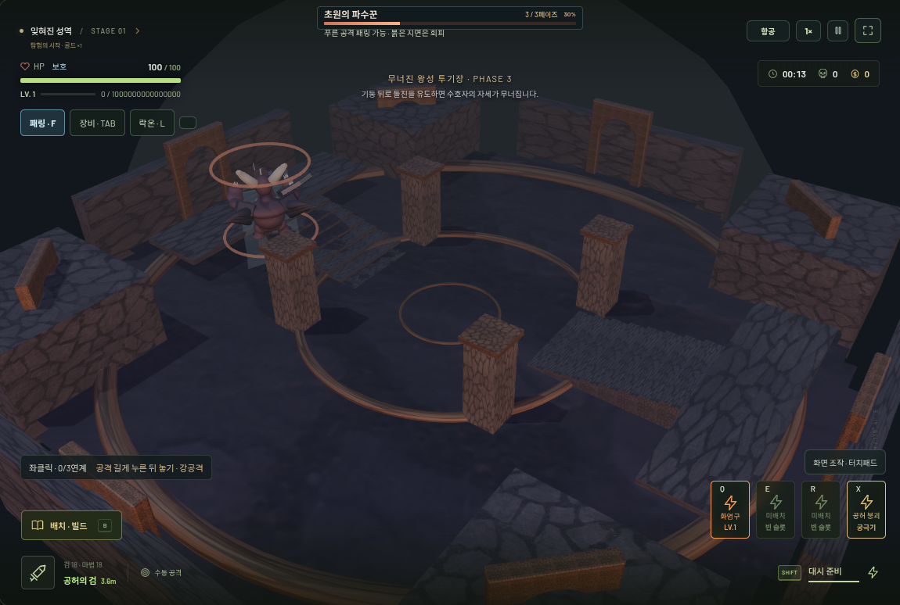
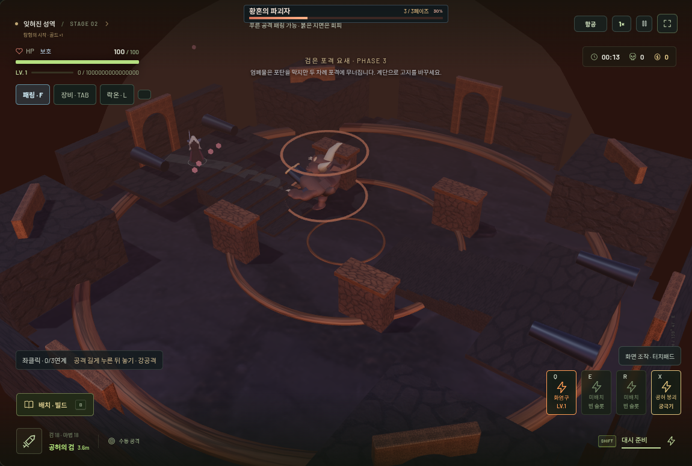
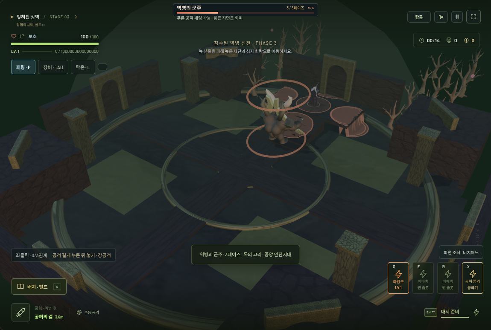
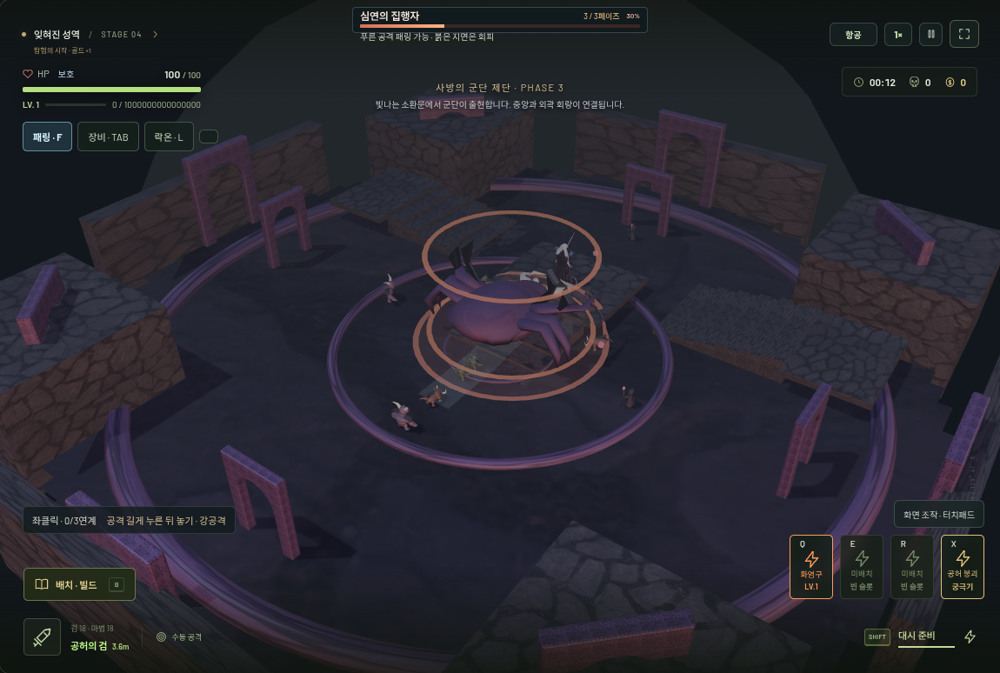
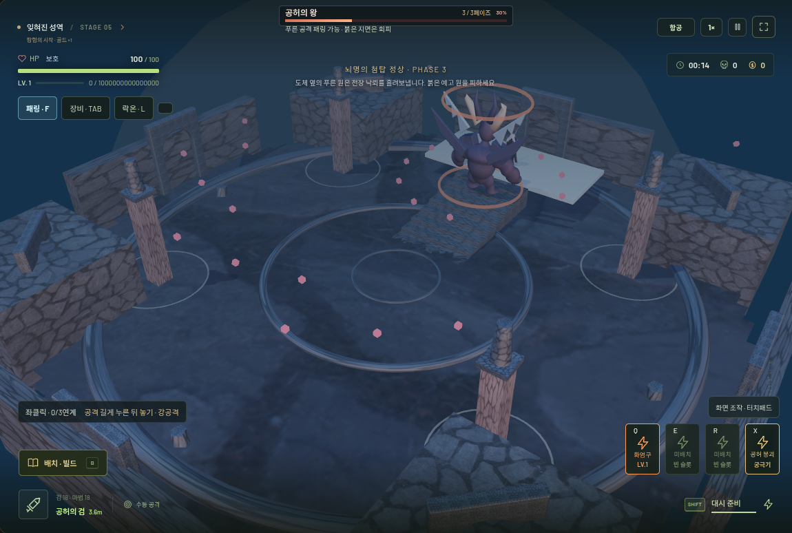
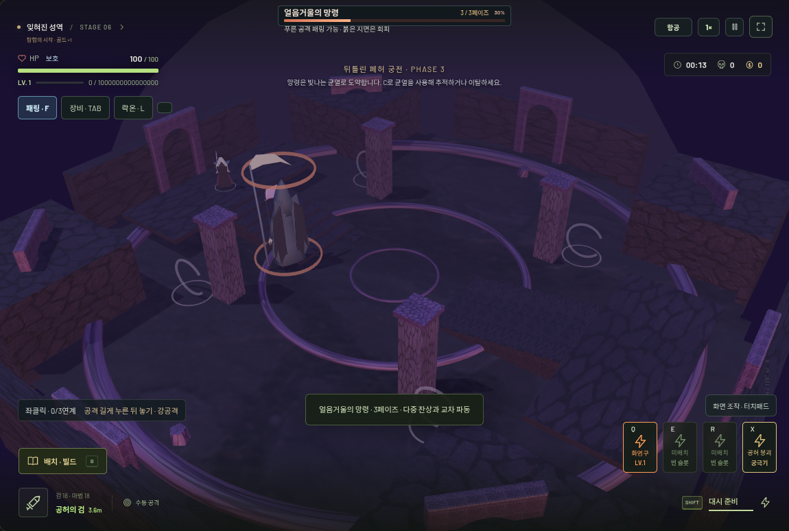

# VOIDRUN v0.24.0 — 보스 전장과 전투 연출

기존 6종 보스와 히든 보스 3종에 별도의 연결된 전장을 추가했습니다. 기존 3페이즈 AI·보스 체력·장비와 성장 수치는 유지합니다. 이전 릴리스는 `v0.22.0` 태그에 보존합니다.

## 전장과 공략

| 보스 | 실제 이동·충돌 구조 | 전투와 연결된 변화 |
| --- | --- | --- |
| 돌진 수호자 | 석조 투기장, 양쪽 관람석과 계단, 돌기둥 | 기둥에 돌진 유도 시 기둥 파괴와 1.65초 회복 동작. 페이즈 2에서 무너진 외벽 격벽 제거 |
| 포격 사냥꾼 | 두 고지대 포대, 계단과 4개 엄폐물 | 실제 포탄 2회가 맞으면 엄폐물 파괴. 엄폐 중에도 조준 포격하고, 격벽 붕괴 후 측면 이동 가능 |
| 역병 지배자 | 침수 신전, 올라선 십자 회랑과 제단, 4개 독성 집수조 | 1.5초 예고 후 집수조 독 분출. 중앙 회랑을 남기고 수문 격벽 개방 |
| 군단 소환자 | 높은 소환 제단, 양쪽 상층, 사방 소환문 | 부하가 실제 소환문 안쪽에서 출현. 2·3페이즈에 서로 다른 문 개방 |
| 폭풍 군주 | 탑 정상, 계단식 고지대, 4개 도체와 접지 원 | 위치가 고정된 낙뢰 예고. 접지 원 안에서는 전장 낙뢰가 생성되지 않음. 최종 페이즈에 추가 낙뢰 |
| 순간이동 망령 | 궁전의 양쪽 회랑과 계단, 교각, 공간 균열 | 보스가 예고된 균열로 도약. 플레이어도 C/상호작용 버튼으로 이동. 최종 페이즈에 4개 균열 사용 가능 |
| 잿빛 왕 | 왕좌 단상, 양쪽 왕실 회랑, 기둥 | 검격·전신 자세와 왕좌 우회 동선. 왕실 봉인 격벽 제거 |
| 공허의 관측자 | 성환과 오벨리스크, 고지대, 균열 | 오벨리스크 엄폐와 예고 도약. 격벽 제거로 시선과 이동 경로 변화 |
| 태초의 심연 | 심연 성소, 양쪽 높은 피난처, 중앙 안전 원 | 새 전장에서는 18m 고리·중앙 4m 안전 원, 1.65초 예고. 바깥쪽으로도 회피 가능. 기존 작은 훈련장 패턴은 유지 |

전장 반경은 30m입니다. 페이즈 전환 1.25초 후 격벽을 제거하며, 이때 물리 충돌·투사체 차단·카메라 충돌·길 찾기를 함께 갱신합니다. 이동 바닥과 유일한 연결 계단을 없애지 않습니다. 플레이어와 큰 보스의 서로 다른 몸체 폭으로 모든 고지대의 접근을 검사합니다. 이동·대시·넉백은 기존의 세부 구간 충돌 검사를 사용합니다.

## 보스의 움직임과 연출

- 몸통·어깨·팔·다리·머리에 보스별 준비·타격·회복 자세를 적용합니다. 수호자는 양팔과 무게중심, 포수는 포격 지지 자세와 반동, 역병은 구부정한 시전과 발톱, 군단은 팔을 벌린 소환, 폭풍은 좌우 도체 자세, 망령과 왕은 허리와 무기 쪽 어깨의 검격을 사용합니다.
- 방패·쌍포·부식 발톱·군단 등지·날개 판금·낫 등 보스의 역할을 읽을 수 있는 무장을 기존 관절 피벗에 연결합니다. 장식이 독립적으로 흔들리지 않고 몸의 공격 자세를 따릅니다.
- 히든 보스의 기존 메시에도 관절 변형을 적용하고, 왕은 복제된 플레이어의 척추·어깨·팔꿈치·골반·무릎·머리카락 관절을 사용합니다. 공유 원본 메시를 변경하지 않습니다.
- 큰 히든 보스의 피격 높이는 보이는 메시의 실제 경계로 계산합니다. 고지대에서 보스 몸체에 닿은 공격이 기본 몬스터의 작은 높이로 잘못 제외되지 않게 합니다.
- 등장 1.25초, 페이즈 안내 0.7초, 승리 0.9초. 이름·칭호·전장명을 표시합니다. 이동·새 공격 입력·대시·Enter·화면 버튼으로 건너뛸 수 있고 설정에서 연출을 끌 수 있습니다. 이미 진행 중인 마지막 검격 때문에 승리 연출이 자동으로 사라지지는 않습니다.
- 카메라 연출은 기존 시점을 기준으로 짧게 보간합니다. 1인칭의 시야 방향을 강제로 돌리지 않으며, 효과 강도·카메라 흔들림 설정을 따릅니다. 승리 안내가 끝나거나 건너뛰면 장비·성장 보상 선택으로 이어집니다.
- 보스마다 다른 네 음의 절차적 배경 모티프와 돌진·포격·독·소환·낙뢰·균열·심연 효과음, 붕괴·등장·페이즈·승리 소리를 추가합니다. 기존 음소거·배경음·효과음 버스와 음성 수 상한을 따릅니다. 외부 음원·이미지·API를 사용하지 않습니다.

## 진행 기록과 기존 시스템

전장은 가역적인 장면 컨텍스트입니다. 밖의 몬스터·드롭·상자·투사체·잔류 마법·변이 폭발과 장비 드롭을 보관하고 전투가 끝나면 돌려놓습니다. 전장 진입 시 보스 방향으로 시점을 맞추고, 복귀 시 이전 위치와 시점 방향을 복원합니다. 전장 보상을 회수하고 원래 탐험으로 복귀하거나, 기존 목표를 완료했다면 보상 선택 후 다음 층 분기로 진행합니다. 미회수 회복 아이템을 층 이동 때 무료 회복으로 바꾸지 않습니다. 마법 사용 횟수·발동 쿨타임·전투 통계를 초기화하지 않습니다. 밖의 지형 위험은 정지하되 전장 안에서 새로 받은 둔화·잔류 독의 시간과 피해는 정상 처리합니다.

히든 보스는 기존 비밀 방 안에 중첩된 전장을 사용합니다. 승리 후 전장 출구 → 원래 방의 보상 제단 → 원래 층으로 복귀합니다. 재시작·런 종료·방 나가기는 전장과 내부 그래픽 자원을 먼저 정리합니다. 저장 스키마와 영구 강화·스토리 해금 규칙은 변경하지 않습니다. 훈련장과 작은 매몰 던전의 보스는 기존 연습/던전 공간을 사용합니다.

## 변경 파일

- 신규: `boss-arena-layout.js`(전장과 구조 변화), `boss-arena.js`(진입·복원·환경 위험), `boss-joints.js`·`boss-motion.js`·`boss-presence.js`(관절·무장), `boss-arena-ui.js`·`.css`(안내).
- 전투·이동: `game.js`, `bosses.js`, `boss-phases.js`, `hidden-bosses.js`, `tactical-ai.js`, `combat-collision.js`, `world.js`, `view.js`, `magic.js`, `equipment.js`, `interaction.js`, `side-areas.js`, `region-system.js`.
- 표시·렌더링: `creatures.js`, `monster-motion.js`, `death-presentation.js`, `terrain-renderer.js`, `explorable-terrain.js`, `regional-landscape.js`, `soundscape.js`, `main.js`.
- 테스트: `boss-arena.test.js`, `boss-arena-smoke.mjs`, `boss-arena-mobile-smoke.mjs` 및 기존 보상/패링 검증의 명시적 연출 건너뛰기·좌표 픽스처. 기존 피해·보상·성장에 대한 단언은 유지합니다. 자원 검사는 세 지역의 플레이어·보스 경로 캐시를 모두 같은 조건으로 준비한 뒤 GC 후 CDP `Runtime.getHeapUsage`의 힙과 backing storage를 측정하고, 기존 1MB 힙 증가 상한을 유지합니다.
- 버전·실행: `package.json`, `package-lock.json`, `README.md`.

## 검증과 한계

재현: `npm test`, `npm run build`, `npm run build:standalone -- dist/VOIDRUN.html`, `BASE_URL=http://127.0.0.1:5302 npm run test:boss-arenas`, `npm run test:boss-arenas-mobile`. 브라우저 주소는 별도로 실행한 Vite preview 주소를 지정합니다. 상세 결과와 실제 렌더링 화면은 함께 기록합니다.

검증 결과: **단위 281/281, 기존·신규 브라우저 검사 27종 통과, 프로덕션·단독 HTML 빌드 통과.** 변경의 영향을 받는 보스·패링·자원·비밀 방·마우스·훈련·모바일 경로는 최종 빌드에서 재검사했습니다. 9개 보스 전장에서 실제 시뮬레이션으로 계단을 올라가고 2·3페이즈를 통과했습니다. 실제 두 포탄의 엄폐/파괴, 돌진 기둥 충돌, 경고 후 지형 피해, F 패링, 수동 검·마법 피해, 락온 유지, 숨겨진 방 보상과 복귀를 확인했습니다. 자동 공격이 다시 발생하지 않았으며, 원래 적·골드·마법·쿨타임·시전 횟수·변이 폭발이 복원됐습니다. 모바일은 실제 터치 이벤트와 390×844·844×390, 낮은 그래픽·세 시점·균열 이동·연출 설정 저장/재로딩을 검사했습니다. 브라우저·셰이더 오류는 없었습니다. 단독 HTML은 독립 실행과 opaque-origin sandbox에서도 확인했습니다.

보스 전장 반복 진입/퇴장 후 GPU 자원은 최종 166 geometry·18 texture로 안정됐습니다. 원래 월드의 16회 혼합 지역 재시작 검사에서도 176 geometry·18 texture가 유지됐고, 캐시가 준비된 마지막 8회에서 힙 증가는 125,472 bytes, backing storage 증가는 10,920 bytes였습니다. 보스+18명 부하의 120프레임 CPU 시뮬레이션 평균은 2.48ms, p95는 8.5ms였습니다. 이는 Chromium/SwiftShader 검증 환경 측정이며 실제 모바일 GPU의 프레임 속도를 보장하는 수치는 아닙니다. [기계 판독 결과와 빌드 해시](boss-arenas-verification.json).

추가 밸런스: 일반 보스 체력·기본 공격력·페이즈 임계값·성장 비용은 유지합니다. 전장 위험 피해는 보스 기본 피해의 45%, 예고는 최소 1.3초이며 최대 5개를 유지합니다. 전장 위험 간격은 통상 8초/최종 페이즈 6초입니다. 중앙 동선·접지 원·고지대·균열과 파괴 가능한 엄폐를 대응 수단으로 제공합니다. 보스 부하의 기존 총 18명 상한과 기존 투사체·파티클·GPU 인스턴싱/LOD 상한을 유지합니다.

## 실제 게임 화면

| 석조 투기장 | 포격 요새 |
| --- | --- |
|  |  |

| 침수 신전 | 군단 제단 |
| --- | --- |
|  |  |

| 첨탑 정상 | 균열 궁전 |
| --- | --- |
|  |  |

[등장 연출](boss-arenas/intro.png) · [모바일 실제 터치 화면](boss-arenas/mobile.png). 이 화면들은 테스트용 보스 스폰·페이즈 설정 후 실제 Three.js 렌더러에서 캡처했습니다.

지형 붕괴는 안전한 동선을 남기는 사전 설계된 격벽·기둥 제거입니다. 자유로운 물리 시뮬레이션이나 바닥 전체의 파괴는 구현하지 않습니다. 애니메이션은 현재 메시의 관절 태그·변형과 플레이어 관절을 활용한 코드 기반 동작이며, 모션 캡처나 완전한 래그돌은 아닙니다. 절차적 음악은 짧은 보스 모티프와 지역 배경음을 조합합니다. 소프트웨어 렌더러에서의 기능·자원 검사와 실제 휴대폰 GPU 성능은 구분해야 합니다.
