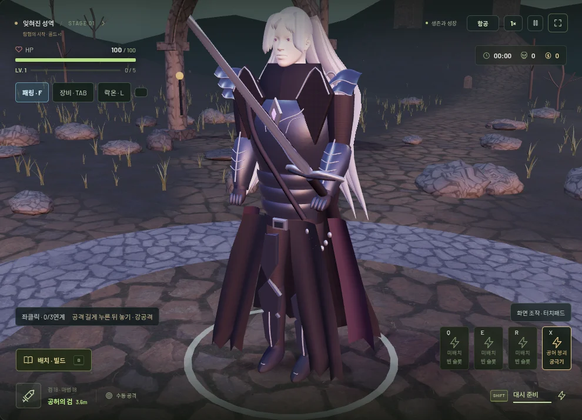
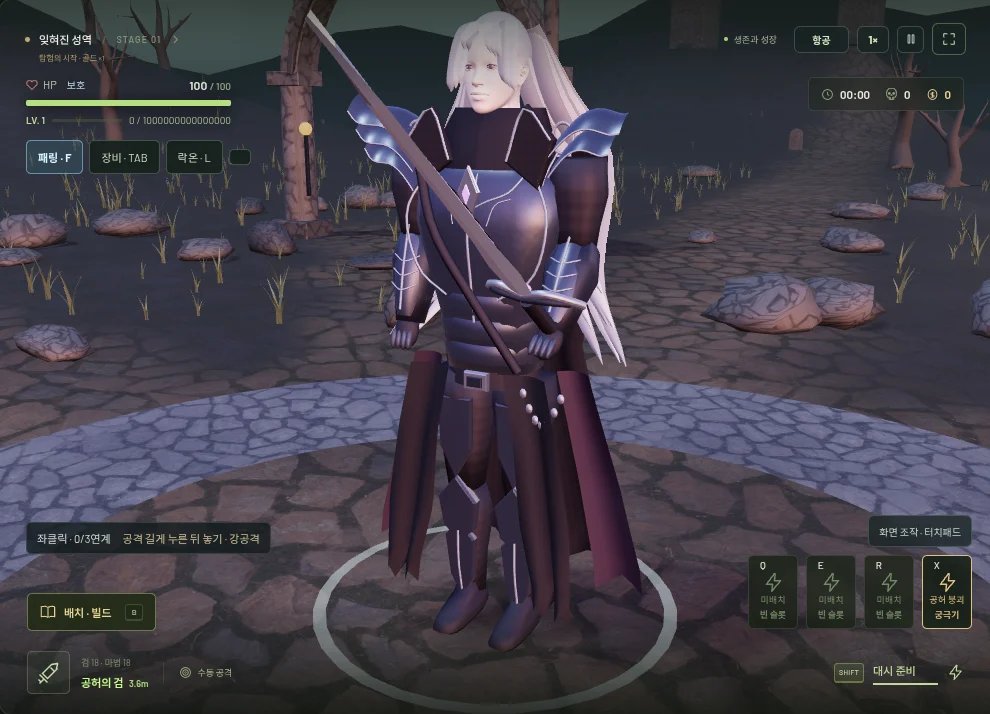
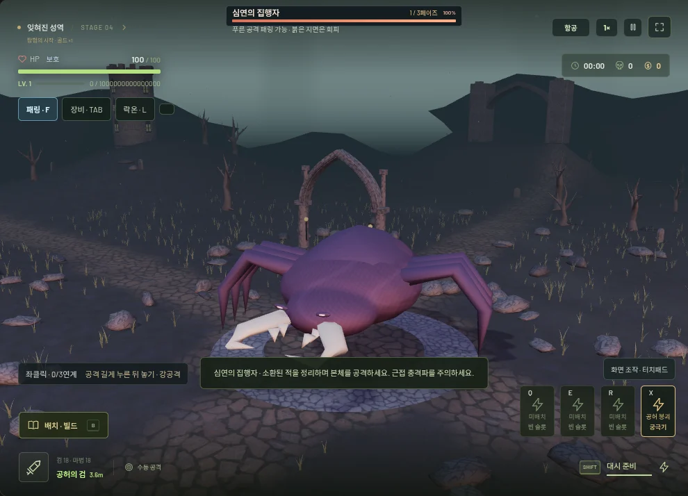
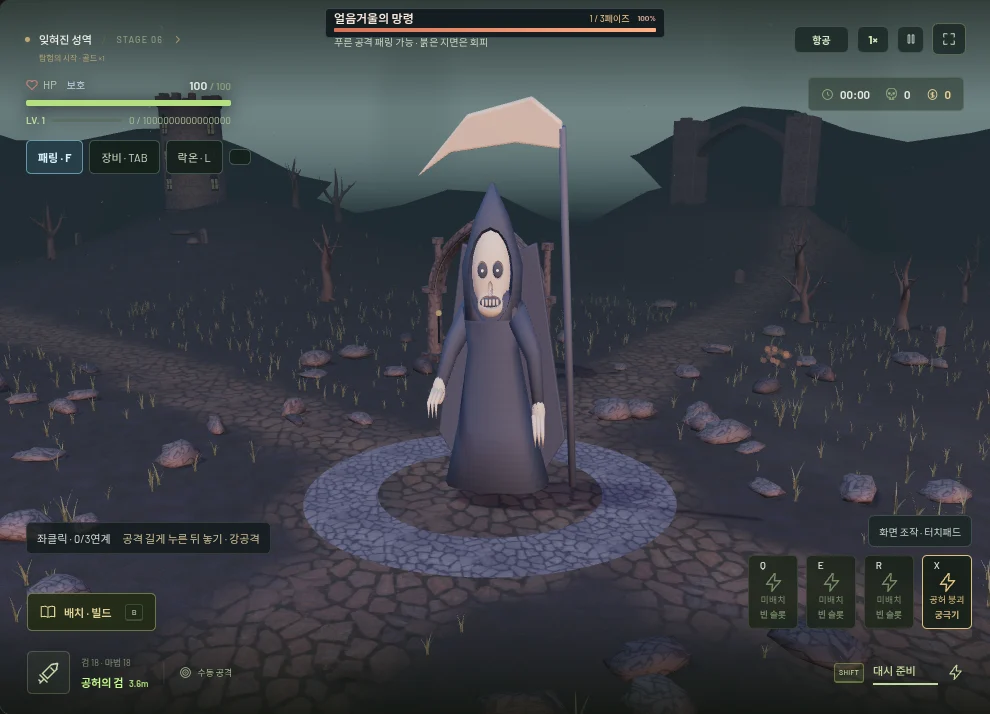

# v0.21.0 — 실루엣과 화면 전투 조작

기준 안정판: `v0.20.2` / `1714e34`. 기존 저장 키·지갑·영구 강화·직업 패시브·보스 AI와 페이즈는 유지한다.

## 형태와 제작 방식

- 플레이어: 폐곡면 흉갑·상완·전완·허벅지·종아리·장화의 실제 메시를 교체했다. 허리, 흉부, 팔꿈치와 종아리 단면을 별도로 설계하고 겹치는 갑옷의 경계와 어깨 실루엣을 정리했다. 원래 CC0 얼굴 토폴로지를 유지하며 눈꺼풀·눈동자 크기, 머리카락의 길이와 겹침, 앞 코트의 폭을 다듬었다.
- 직업/무기: 비전술사·광전사·암살자·소환술사·성기사·흑마법사의 칼라·견갑·후드·마도서·방패·뿔 형태를 별도 키트로 추가했다. 기존 기본 직업 외형을 유지하며 선택 직업의 키트만 표시한다. 기본 검·대검·질풍검은 각각 직검·넓은 파쇄 날·휘어진 날의 실제 메시를 사용한다. 양손 무기는 같은 선택 날을 공유한다.
- 일반 몬스터 9종과 수호자 기본형: Blender에서 살과 근육을 합쳐 연속 표면으로 만든 뒤 오프라인 리메시·감량했다. 큰 귀와 엄니의 고블린, 턱·발과 등 갈기가 있는 늑대, 넓은 체형의 중장갑 적, 열린 두건의 마법사, 엄니 멧돼지, 다리가 꺾이는 갑충, 이빨이 있는 분열체, 드러난 갈비뼈의 궁수, 뿔 달린 주술사 등을 기존 종류/행동에 연결했다.
- 보스: 수호자의 넓은 견갑과 왕관, 포격자의 열린 포신, 역병 군주의 등 혹과 뿌리 뿔, 다족형 소환자의 턱과 여섯 다리, 폭풍 군주의 분리된 날개판, 해골 로브 망령의 낫과 찢어진 망토를 각각 전체 실루엣에 포함했다. 소환자의 다리는 몸에 연결된 각 관절을 중심으로 움직인다. 비밀 보스 관측자와 태초의 존재도 새 연속 메시로 교체했고, 몰락한 왕은 새 플레이어 모델과 대검을 사용한다. 발광하지 않는 표면에 보스 색상의 자체 발광을 더하지 않아 형태의 음영을 유지한다.
- 환경: 시작 지역의 바위와 나무, 화산의 부서진 현무암, 설원의 기울어진 결정, 숲의 굽은 나무와 주름 버섯, 유적의 버팀 기둥, 공허의 깨진 첨두 아치를 실제 형태가 다른 메시로 바꿨다. 월드 건물·이동 지형·충돌체 전체를 새로 제작한 것은 아니다.

`bake-silhouettes.py`가 원본 제작 파일이다. glTF의 별도 로더 대신 기존 GPU 관절·인스턴싱에 바로 연결되는 로컬 바인드 메시를 내보낸다. 모델별 재료와 관절을 유지한 채 합치며, 게임 중에는 메시 제작 작업을 하지 않는다. 추가 외부 모델은 없고 기존 얼굴·PBR의 출처를 유지한다. [제작·출처](../licenses/SCULPTED-MODELS.md).

## 함께 마무리한 전투 조작

- 기본 검 사거리 **2.8 → 3.6m (+28.6%)**. 부채꼴·검 궤적·충돌이 같은 프로필을 사용하며 범위 강화와 진화는 계속 곱해진다. 기본 피해·공격 횟수·대상 수·강화 가격을 올리지 않는다. 반격도 기존 `검 사거리 ×1.25`, 최대 7m 규칙에 따라 시작 반경 4.5m가 된다.
- 공격 버튼/좌클릭을 짧게 눌렀다 놓으면 일반 공격, **0.28초 이상 누른 뒤 놓으면 강공격**이다. 배속 때문에 짧은 누르기가 강공격으로 바뀌지 않는다. 누르고 있는 동안 선행 일반 공격이나 반복 공격이 나가지 않는다. 대검의 추가 차징과 4초 강공격 쿨타임은 유지한다. 쿨타임 중에는 일반 공격으로 연결된다. 기존 우클릭/재지정 강공격도 남긴다.
- 시작 화면의 **화면 조작 · 터치패드** 또는 설정 → **전투 조작 방식**에서 커서 조작을 선택한다. 마법 3칸·궁극기를 공격 버튼 위로 모으고 이름·준비 상태·쿨타임을 표시한다. 커서를 풀어 화면 버튼으로 직접 사용하며, 1·3인칭에서는 전장을 좌클릭 드래그해 시점을 돌린다. 기본 마우스 고정 모드와 터치 이동 선회는 유지한다.
- 입력 소유자를 구분해 다른 손가락을 놓아도 공격이 발사되지 않는다. 취소·포커스 이탈·메뉴 진입·대시/패링 취소는 보류된 공격을 지운다. 자동 공격을 추가하지 않는다.

## 성능과 검증

모델은 양자화한 이진 배열로 저장하고 필요할 때 한 번만 디코딩한다. 일반 적은 기존 재료별 GPU 인스턴싱과 관절 LOD를 계속 사용한다. 지역 장식도 기존 개체 수의 인스턴스로 배치한다. 개체 수/파티클 상한·그래픽 해상도·그림자 설정을 줄여 성능을 맞추지 않는다.

**단위 테스트 250/250 · 브라우저 검사 21종 통과 · 프로덕션/독립 HTML 빌드 통과.** 160마리 고정 장면에서 179 draw calls / 730,802 triangles를 확인했다. 네 번의 같은 재시작 장면에서 geometry 222개·texture 18개가 유지됐고, 16번의 별도 지역/개체 반복 검사에서도 리소스가 준비 이후 안정됐다. 이 수치는 해당 장면의 리소스 검사이며 이전 버전 대비 FPS 개선 수치가 아니다.

검증 결과는 [silhouettes-verification.json](silhouettes-verification.json)에 기록한다. `npm test`, `npm run build`, `npm run build:standalone -- dist/VOIDRUN.html`, 실행 중인 미리보기 주소를 `BASE_URL`로 지정한 `npm run test:silhouettes`, `npm run test:trackpad`로 재현한다. 기존 전투/시점/모션/패링/지역/저장 관련 브라우저 검사도 실행했다. 과거 검사에서 잠긴 마우스로 메뉴를 클릭하던 부분은 실제 V키로 항공 시점에 진입한 뒤 클릭하도록 수정했다. 반격 범위 밖 표적과 추가 마법의 교체 선택도 현재 규칙에 맞춰 검증한다.

## 실제 렌더링 비교

동일한 게임 카메라로 기존 모델과 새 플레이어를 비교했다. 모델 비교용 촬영의 기존 화면에도 먼저 적용한 입력 UI/3.6m 범위가 표시된다. 나머지는 새 모델과 기존 지역·조명으로 렌더링한 브라우저 검사 화면이다.

| 기존 플레이어 | 새 플레이어 |
| --- | --- |
|  |  |

| 다족형 소환자 | 해골 로브 망령 |
| --- | --- |
|  |  |

[숲의 새 구조물](silhouettes/forest-after.webp) · [모바일 게임 화면](silhouettes/mobile-after.webp).

한계: 절차적 원본을 Blender에서 합치고 다듬은 스타일화 모델이다. 전문 아티스트의 수작업 캐릭터, 전체 PBR 베이크, 얼굴 리깅이나 모든 건축물 교체 수준은 아니다. 새 메시 때문에 이전보다 전송량·근거리 폴리곤 수가 늘었다. Chromium 소프트웨어 렌더러와 터치 에뮬레이션 결과는 실제 iPad/Safari나 저사양 GPU의 프레임률 보증이 아니다.

## 변경 파일

- 제작/모델: `scripts/bake-silhouettes.py`, `src/assets/sculpted-models.json`, `src/sculpted-models.js`, `src/player-model.js`, `src/creatures.js`, `src/monster-motion.js`, `src/bosses.js`, `src/hidden-bosses.js`, `src/classes.js`, `src/world-art.js`, `src/regional-landscape.js`.
- 입력/UI/범위: `src/action-combat.js`, `src/action-ui.js`, `src/action-ui.css`, `src/view.js`, `src/sword.js`, `src/game.js`, `src/main.js`.
- 검증: `tests/sculpted-models.test.js`, `tests/silhouettes-smoke.mjs`, `tests/trackpad-smoke.mjs`, 기존 검·보스·반격 테스트, `package.json`.
