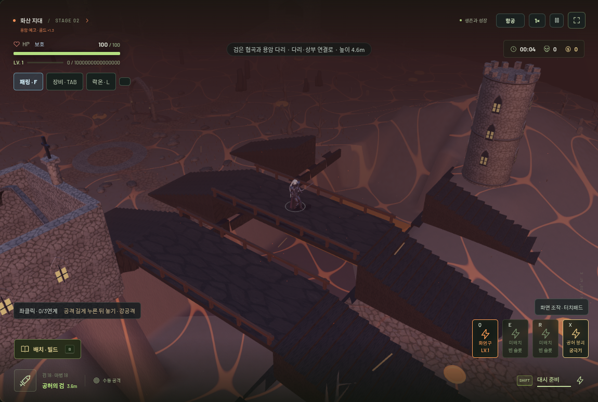
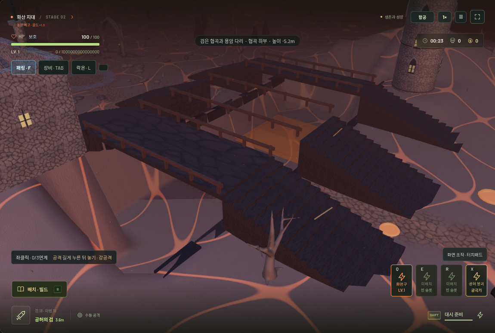
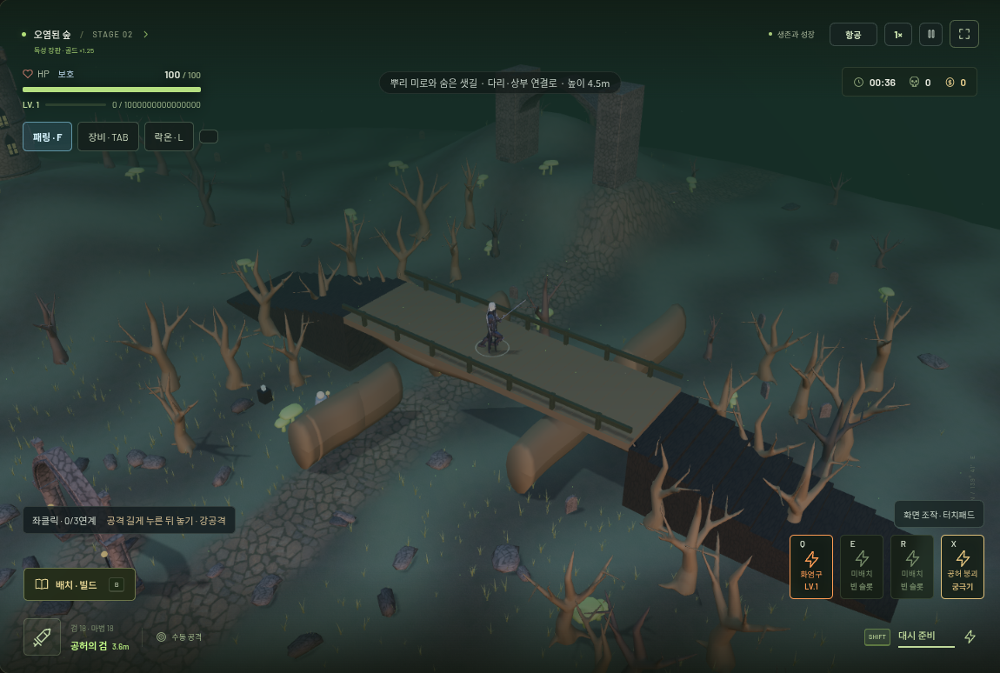
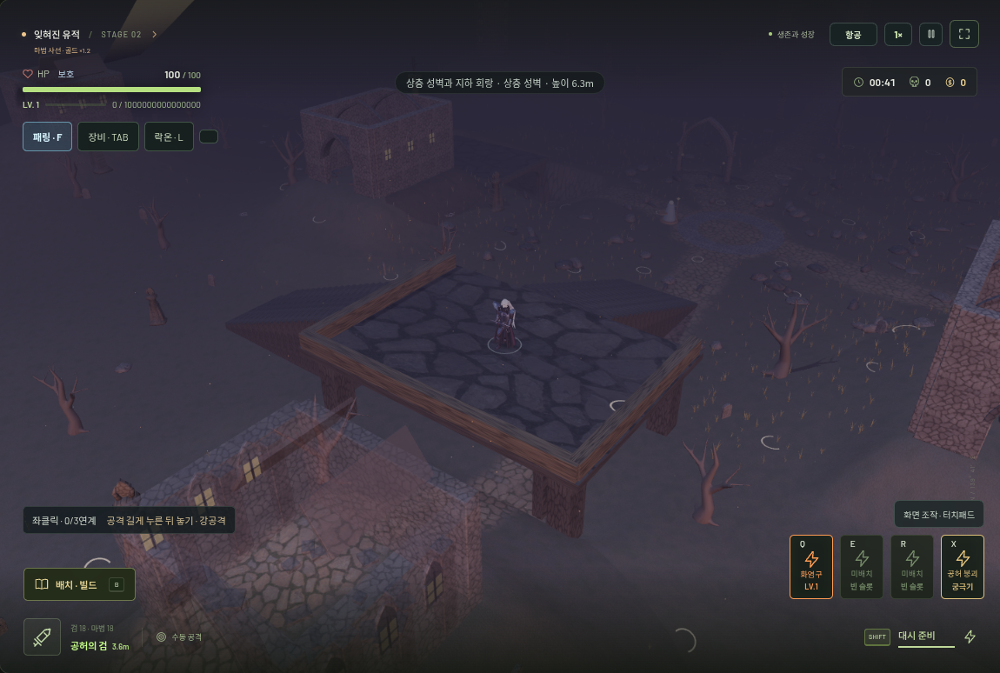
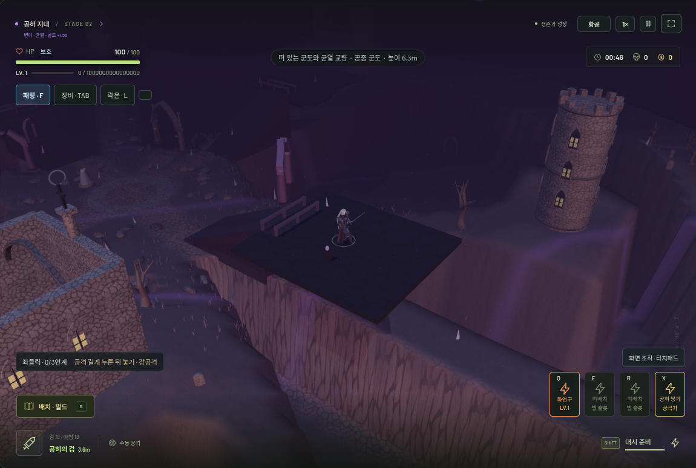
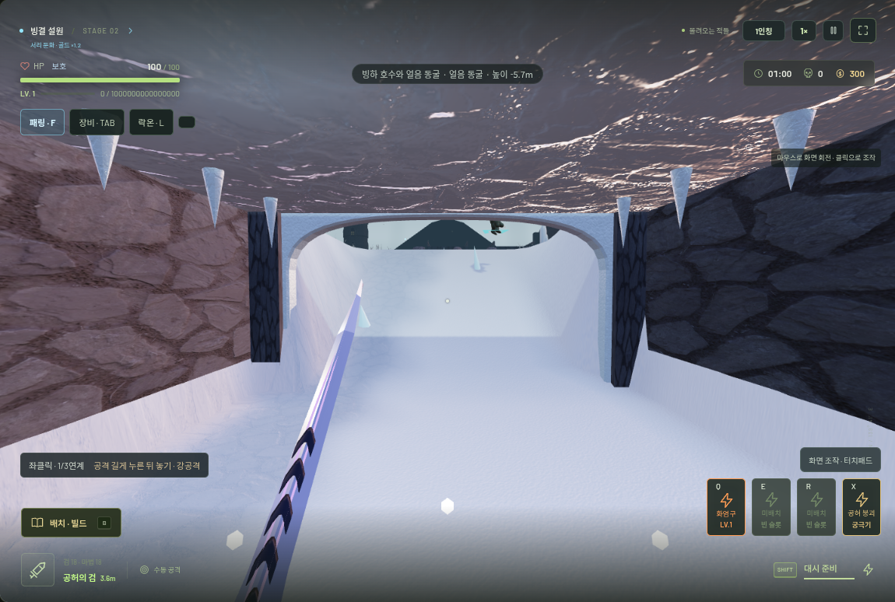
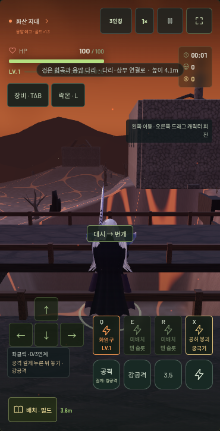

# VOIDRUN v0.22.0 — 입체 지형과 접지 애니메이션

기존 v0.21.0 모델과 전투 조작을 유지하면서, 같은 X/Z 좌표에 다리와 하부 통로가 함께 존재하는 이동 면을 추가했습니다. 단순 색상 변경이나 장식용 지형이 아니라, 플레이어·적·목표·검·마법·카메라가 공통 지형 데이터를 사용합니다. 이전 버전은 `v0.21.0` 태그에 보존됩니다.

## 실제로 달라진 공간

| 지역 | 이동·전투에 사용되는 구조 | 탐험·위험 요소 |
| --- | --- | --- |
| 화산 | 낮은 협곡, 양쪽 계단이 연결된 두 교량, 하부 진입 경사로 | 윈치로 보조 교량 개방. 협곡 용암은 3초 예고 후 2초간 활성화하며 다리 위에는 피해를 주지 않음 |
| 설원 | 얼음 호수, 상부 교량, 아치 입구와 천장이 있는 얼음 동굴 | 호수 이동 속도 10% 감소. 동굴의 봉인 벽 파괴와 숨은 보상 |
| 숲 | 실제 충돌하는 나무, 곡면 뿌리 몸체의 미로, 계단과 뿌리가 받치는 목재 통로, 지하 통로 | 공격으로 뿌리 샛길 개방, 숨은 탐험 보상 |
| 유적 | 교각을 갖춘 상층 성벽, 두 계단, 하층 회랑, 서쪽 지하 통로 | 하층 레버로 비밀문 개방. 상·하층에서 서로 다른 동선 사용 |
| 공허 | 높이가 다른 네 공중 섬, 계단식 연결로와 교량 | 동·서 섬의 공간 균열 이동. 이동·대시·넉백이 절벽 가장자리에서 멈춤 |
| 성역·최종 지역 | 협곡·성벽·지하 회랑을 결합한 구성 | 기존 첫 층·최종 층 생존 및 보스 진행 유지 |

각 구성은 3가지 배치 변형을 사용합니다. 기존 10층 분기, 심연, 건축물·비밀 던전·NPC·보상은 유지합니다. 2–9층의 목표 장치는 해당 지역의 이동 가능한 탐험 지점을 사용하며, 기존 건물 주변 진입로도 보존합니다. 레버와 비밀 기록은 기존 상호작용 키/모바일 버튼으로 사용합니다. 봉인 벽과 뿌리는 실제 검격·화염구·서리 피해로 파괴됩니다.

탐험 보상은 기록당 해당 층 기본 코인 가치의 5배이며 한 층에서 한 번만 받습니다. 기본 검 피해·사거리·공격 표식 시점, 성장 비용, 영구 능력치, 적의 체력 배율은 변경하지 않았습니다.

## 이동·전투 연결

- 발 위치를 기준으로 현재 이동 층을 유지합니다. 계단은 실제 디딤판이며 경사로와 함께 오르내릴 수 있습니다. 동굴 바닥에서 같은 좌표의 지붕 위로 튀어 오르지 않습니다.
- 이동과 대시·넉백을 짧은 구간으로 나누어 검사합니다. 벽 통과와 절벽 낙하를 막으며, 막혔을 때 가능한 축 방향으로 미끄러져 이동합니다.
- 다층 공유 길 찾기를 사용합니다. 일반 적과 큰 보스는 다른 몸체 높이·통과 폭을 검사하며, 낮은 동굴에는 큰 보스가 들어가지 않습니다. 적은 현재 타깃 또는 방어 장치가 있는 층으로 접근합니다. 바로 위·아래에 대상이 있어도 평면 거리만 보고 공격을 반복하지 않고 연결 통로를 찾습니다. 명시적으로 층을 옮기는 순간이동도 수평 이동과 구분합니다.
- 검은 적의 실제 몸체 높이와 전방 범위를 검사합니다. 투사체는 실제 3D 궤적으로 날아가며 벽·바닥·천장에 막힙니다. 마법 설치점은 도착 지형 높이를 사용해 벽 앞에서 멈춥니다.
- 패링 충격파, 장비 세트의 광역 피해, 사망 폭발, 대시 충격파, 소환수도 벽·층 차단을 따릅니다. 보스는 벽 너머에서 바로 공격을 시작하지 않습니다.
- 카메라 팔은 지형의 3D 경계와 충돌합니다. 항공 시점에서 지하에 들어가면 해당 지붕만 옅어지고, 1·3인칭에서는 천장이 유지됩니다. 1인칭의 수직 이동은 계단에서 부드럽게 이어집니다.
- 기존 장식과 풀은 새 통로·교량·협곡을 침범하거나 공중에 남지 않도록 조정합니다. 보상·NPC·포털·드롭과 마법의 원형 효과·파티클·잔류 화염은 자신이 놓인 층을 유지합니다.

## 움직임

플레이어는 연결된 골반·상체 관절 계층을 사용합니다. 발걸음은 실제 이동 거리에 맞추고, 접지 중인 발은 월드 위치를 유지합니다. 두 관절 IK로 허벅지·무릎·발목을 연결하고 발바닥은 지면 경사에 맞춥니다. 급정지 시 발을 0.2초에 걸쳐 내려놓으며, 가속·감속·옆걸음·방향 전환·대시에서 골반과 상체의 무게중심을 달리합니다.

일반 베기·쌍검·대검·검기 찌르기·반격에 준비/접촉/후속/회복 자세를 제공합니다. 기존 실제 공격 표식은 유지하며 각 접촉 시점에 맞춰 자세를 재생합니다. 대검은 양손 연결 IK를 사용하고, 화염·서리·번개·룬 시전은 서로 다른 팔·상체 자세를 사용합니다. 패링 자세와 강공격 피격 후 주저앉음/복귀도 실제 상태에 연결됩니다. 자유 마우스 시점과 공격 중 조준 변경은 유지합니다.

일반 적은 이족·사족·다족의 관절 배치를 유지하면서 팔꿈치·무릎의 추가 굽힘을 GPU 스키닝에 연결합니다. 실이동 거리, 경사, 준비·타격·시전, 보스 전술 계열, 피격 방향, 경직에 따라 관절이 반응합니다. CPU 렌더와 GPU 인스턴싱·그림자에도 같은 변형을 적용합니다. 처치 시에는 보상과 AI를 즉시 정리하고 제한된 수의 사체 복사본에 관절 붕괴·기울어짐·소멸을 재생합니다.

## 구조와 성능

- `terrain-layout.js`: 지역 구조, 이동 면, 벽·슬래브, 파괴물, 레버, 안전 지점, 공유 다층 경로 그래프.
- `terrain-renderer.js`, `explorable-terrain.js`: 같은 경계로 만든 실제 모델, 천장 가림, 용암 예고, 탐험 보상, 층별 이동, 캐시와 자원 해제.
- `world.js`, `world-art.js`, `regional-landscape.js`, `region-system.js`: 기존 월드·지역·장식 통합.
- `grounded-motion.js`, `action-poses.js`, `player-model.js`, `creatures.js`: 접지 IK, 관성, 골반/상체, 무기별 자세와 시전.
- `monster-motion.js`, `enemy-renderer.js`, `death-presentation.js`: 추가 관절 스키닝, 인스턴스 포즈, CPU/GPU 일치, 제한된 처치 연출.
- `combat-collision.js`, `game.js`, `magic.js`, `bosses.js`, `parry.js`, `parry-feedback.js`, `sets.js`, `classes.js`, `mutations.js`, `tactical-ai.js`: 높이·벽을 고려한 전투·AI·연계.
- `stage-objectives.js`, `interaction.js`, `exploration.js`, `side-areas.js`, `view.js`, `combat-aim.js`, `main.js`, `style.css`: 목표 배치·상호작용·3시점·현재 지형 표시·지역 설명.

벽 검사는 공간 버킷을 사용하고, 경로 탐색은 무리 전체가 공유합니다. 목표별 흐름장은 최대 4개, 지역 모델/그래프 캐시는 최대 3개입니다. 같은 배치의 새 런은 초기 그래프를 재사용하고, 문을 열거나 벽을 부쉈을 때만 경로를 갱신합니다. 적의 조향·경사 샘플 갱신을 분산합니다. 계단과 벽은 재질별로 병합하고 기존 GPU 인스턴싱·LOD·파티클·드롭·사체 상한을 유지합니다.

## 검증

**단위 테스트 264/264, 브라우저 스위트 24종 통과.** 마지막 환경 모델/가림 수정 후 관련 6종도 재실행해 통과했습니다. 세부 측정은 [검증 기록](terrain-motion-verification.json), 현재 배포 커밋은 [빌드 정보](https://pms0402.github.io/pms/version.json)에서 확인할 수 있습니다.

- 7개 지형 구성 × 3개 배치의 주요 경로를 실제 캡슐 이동으로 검사했습니다.
- 5개 분기 지역의 목표 지점 50개가 현재 층에서 서 있을 수 있고 연결되어 있음을 브라우저에서 확인했습니다.
- 교량 레버의 실제 개방·양쪽 계단 통과, 하부 협곡 이동과 시점별 상판 가림, 지하 보상과 검으로 봉인 파괴를 확인했습니다.
- 지붕 위 근접 적의 지하 추적과 원거리 적의 입구 우회·실제 투사체 피해, 층간 차단과 지하 마법 효과를 확인했습니다.
- 주요 경로 보행 중 접지 목표와 실제 발목 위치의 평균 오차는 약 3–5cm였습니다. 프레임률 30/60/120Hz, 정지·회전·콤보·배속·일시정지 검사는 기존 전투 수치를 유지했습니다.
- 160마리/676개 부품이 인스턴싱으로 표시되고, 마지막 캡처는 221개 드로콜이었습니다. 이 값은 특정 검증 장면의 측정이며 실제 기기 FPS를 의미하지 않습니다.
- 16회 혼합 지역 전환/재시작 후 동일한 3개 지역 캐시를 놓고 측정한 후반 GPU 지오메트리 수는 일정했습니다. 캐시 3개, 빈 CPU 포즈 캐시, 텍스처·힙 증가 제한을 통과했습니다.
- 기존 저장·영구 강화·장비·세트·유물·보스 3페이즈·비밀 던전·심연·훈련·수동 공격·마우스/터치 조작과 독립 HTML도 검사했습니다. 이전 `v0.16.0.html`의 SHA-256도 그대로입니다.

재현 명령:

```sh
npm test
npm run build
npm run build:standalone -- dist/VOIDRUN.html
npm run preview -- --port 5301
BASE_URL=http://127.0.0.1:5301 npm run test:topology
BASE_URL=http://127.0.0.1:5301 npm run test:topology-mobile
```

지형 단위 검사는 7개 구성 × 3개 배치의 탐험 지점·기존 건물 진입로·실제 캡슐 이동을 검사합니다. 추가 검사에는 상·하층 분리, 천장 충돌, 벽 파괴, 선택 교량, 발 접지·정지, 관절 연결, 공격 자세의 연속성, 바닥 높이에 따른 마법 배치를 포함합니다.

기존 외형 검사의 로컬 머리 좌표는 월드 높이 비율로, 다리를 0도로 되돌리는 검사는 실제 발 접지 오차로 바꿨습니다. 투사체 테스트는 바닥 속 좌표 대신 실제 비행 높이를 사용하며, 강공격 연계 검사는 즉시 밀려난 적을 따라간 뒤 검격을 연결합니다. 공격 지연·배율·비자동 공격·저장 호환성 검증은 유지합니다.

브라우저 검사에서는 주요 지역 실제 이동, 지하 진입·보상·검으로 벽 파괴, 층간 피해 차단, 세 시점, 지역별 목표 배치, 160마리 군중을 확인합니다. 네이티브 터치 이벤트로 상층 공격·패링·절벽 방향 대시, 세로/가로 모바일 화면과 낮음 품질을 확인합니다. 기존 저장·전투·유물·장비·보스·던전·훈련·조작·자원 재사용 검증도 유지합니다.

## 실제 게임 화면

안전하게 이동·충돌을 반복 검증한 런에서 캡처했습니다. 화면은 게임의 실제 Three.js 렌더이며, 경로 검증 동안 적 스폰과 레벨업은 제한했습니다.









## 남은 한계

이 지형은 지역당 세 가지 배치 변형을 가진 설계형 다층 맵입니다. 임의의 메시 전체를 탐색하는 범용 3D 내비게이션 엔진이나 완전 절차 생성 던전은 아닙니다. 자유 점프·낙하는 추가하지 않았으며 절벽에서 멈추는 방식입니다.

플레이어 접지와 관절 스키닝은 기존 메시를 사용하는 실시간 애니메이션입니다. 전문 모션 캡처 클립이나 완전한 물리 래그돌은 도입하지 않았습니다. 매우 급한 지형 전환·발 디딤 길이의 한계에서 잔여 미끄러짐이 있을 수 있습니다. 모바일 검사는 Chromium 터치 에뮬레이션이며 실제 iPhone/iPad/Android 기기 성능은 별도 확인이 필요합니다. 소프트웨어 GPU에서 측정한 시간은 실제 기기의 FPS를 보장하지 않습니다.
